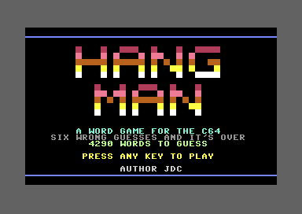
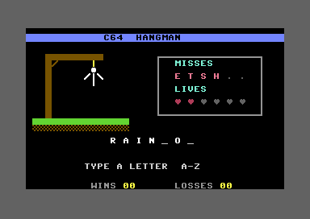
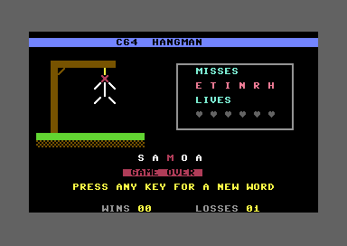

# C64 HANGMAN

A hangman game for the Commodore 64, written in 6502 assembly (ACME).
It draws straight to screen memory, plays SID sounds and jingles, and
comes in two sizes: a normal build with 4,290 words and an **XL** build
that packs 7,565 words into the RAM under the BASIC ROM.

Author: JDC

<p align="center">
  
  
  
</p>

## Quick start

```sh
make run        # build build/hangman.prg and run it in VICE (x64sc)
make run-xl     # the same for the XL build
make d64        # build/hangman.d64 with both games on it
```

Requirements: [ACME](https://sourceforge.net/projects/acme-crossass/) 0.97,
[VICE](https://vice-emu.sourceforge.io/) (`x64sc`, `c1541`),
[exomizer](https://bitbucket.org/magli143/exomizer/wiki/Home) 3.1 for the
packed builds, and Python 3 only to regenerate the word lists. Developed
and tested on macOS.

## How to play

* Press any key on the title screen to start.
* Type a letter **A-Z** to guess. Letters you already tried are ignored.
* A right letter appears in the word with a chime. A wrong one goes in the
  MISSES box, adds a piece to the man, flashes the border and costs a life.
* **Six wrong guesses** and the game is over; the word is shown.
* Press any key for a new word. The same word never comes up twice in a row.
* WINS and LOSSES are counted for the session (up to 99).

Keys typed while a sound plays are ignored, so mashing the keyboard
doesn't spend guesses.

## Play it

| File | What it is |
|---|---|
| `build/hangman.d64` | Disk image with both games. `LOAD"*",8,1` loads the normal one; `LOAD"HANGMAN XL",8,1` loads the XL one. Then `RUN`. |
| `build/hangman-packed.prg` | Normal build, exomizer-packed, 19 KB (76 blocks). |
| `build/hangman-xl-packed.prg` | XL build, exomizer-packed, 39 KB (157 blocks). |
| `build/hangman.prg` | Normal build, unpacked, 38 KB. Starts with `SYS 2061`. |
| `build/hangman-xl.prg` | XL build, unpacked, 42 KB. |

The packed files unpack themselves and start the game after `RUN`.
Everything runs on a stock PAL or NTSC C64. The music is tuned for PAL;
on NTSC it plays about 4% sharp at the same tempo.

## Build targets

| Target | Output |
|---|---|
| `make` | `build/hangman.prg` |
| `make xl` | `build/hangman-xl.prg` |
| `make crunch` | `build/hangman-packed.prg` and `build/hangman-xl-packed.prg` (exomizer `sfx sys`) |
| `make d64` | `build/hangman.d64` with files `HANGMAN` and `HANGMAN XL` |
| `make run` / `make run-xl` | build and autostart the unpacked PRG in `x64sc` (PAL, injected straight into RAM) |
| `make run-d64` | build the disk and boot it from the emulated 1541 |
| `make ultimate` / `make ultimate-xl` | send the PRG to a C64 Ultimate over its REST API and RUN it (`tools/run_ultimate.sh`; `ULT_HOST=`, `ULT_FILE=build/hangman.d64` mounts the disk instead, `ULT_PASSWORD=`, `ULT_DRY=1` only prints) |
| `make words` | regenerate `words.asm` and `words_xl.asm` from `wordsrc/` |
| `make internet-archive` | `internet-archive/`: every PRG, the d64, `c64-hangman-<version>.zip` and a `README.TXT` for archive.org (template in `dist/README.TXT.in`; set `VERSION=` or tag a release) |
| `make clean` | remove `build/` |

Override the tools with `ACME=`, `X64=`, `C1541=` or `EXOMIZER=`.

## Files

```
hangman.asm          the whole game: setup, game loop, word picker, drawing,
                     title screen, SID sound engine, songs and screen data
words.asm            generated: 4,290 words, plain text (normal build)
words_xl.asm         generated: 7,565 words, 5-bit packed (XL build)
tools/gen_words.py   builds the word lists
wordsrc/             google-10000-english-no-swears.txt, the source word list
docs/screenshots/    the pictures above
Makefile
```

## How it works

**Memory.** The program starts at `$0801` with a BASIC `SYS 2061` line.
Code and data come first, then the word list. The normal build ends at
`$9DBF`, just below the BASIC ROM at `$A000`. The XL build switches the
BASIC ROM out (`$01 = $36`) and ends at `$AFDF`, with room to spare
before the I/O area at `$D000`. The assembler stops with an error if
either list grows past its limit.

**Word lists.** `tools/gen_words.py` takes 16 C64-themed words
(COMMODORE, KERNAL, DATASETTE, ...) and then the most common 5-12 letter
words from the
[google-10000-english](https://github.com/first20hours/google-10000-english)
list, skipping web junk like HTTP and JAVASCRIPT, until a byte budget is
used up.

* Normal build: each word is ASCII capitals plus a 0 byte.
* XL build: each letter is 5 bits (A=1 ... Z=26) and 0 ends a word, so a
  word takes 5/8 of the space.
* Both have an index of every 32nd word, so picking a word means one table
  lookup and skipping at most 31 words.

```sh
python3 tools/gen_words.py 35500             # words.asm, 35,500-byte budget
python3 tools/gen_words.py --packed 46000    # words_xl.asm
```

The word count on the title screen is worked out when the program is
assembled.

**Randomness.** SID voice 3 runs as a muted noise generator. The word
picker mixes it with the raster line, the jiffy clock and a counter that
runs while you think, then rolls again until the number is below the word
count, so every word is equally likely.

**Sound.** A small blocking player drives SID voices 1 and 2: a click when
a letter is accepted, a chime for a right letter, a buzz for a wrong one,
and jingles for the title, a win and a loss. Tempo comes from the KERNAL
jiffy clock, which runs at 60 Hz on both PAL and NTSC. Each voice uses the
same attack, decay and release rate, so the SID's envelope-counter
("ADSR delay") bug can't swallow short notes.
